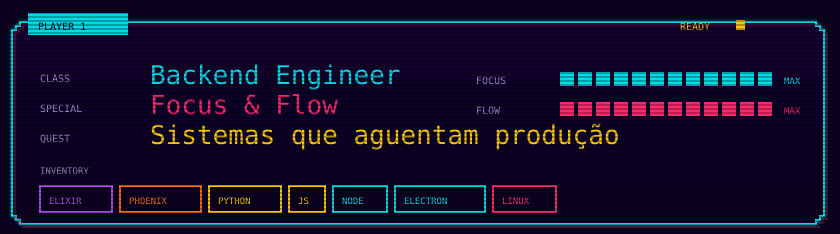
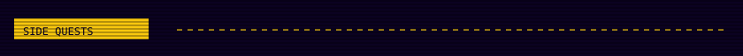
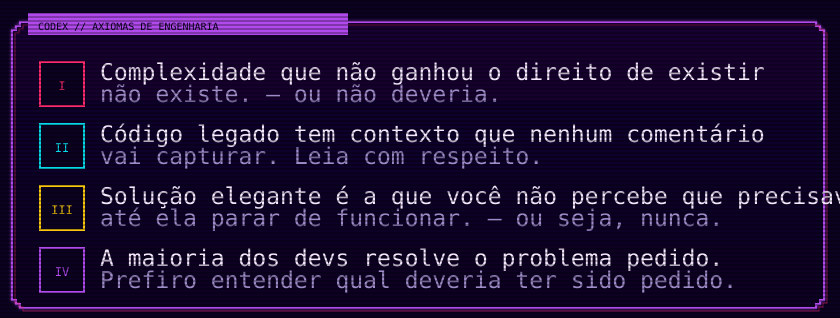
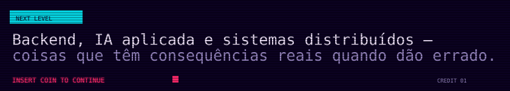

  

  

  

  

  

| Quest | O que é | Stack |
|---|---|---|
| [**Lynx Assistant**](https://github.com/gabterm/Lynx-Assistant) | Assistente desktop open source: automatiza tarefas com comandos simples. Engine separada da UI, comandos extensíveis | Python |
| [**DoubleCheckSec**](https://github.com/gabterm/DoubleCheckSec) | Autenticação em dois fatores com TOTP, cadastro por QR Code e segredos cifrados com AES | Python |
| [**Phoenix Realtime Chat**](https://github.com/gabterm/Phoenix-Realtime-Chat) | Chat em tempo real com Phoenix Channels, explorando concorrência, processos leves e PubSub | Elixir, Phoenix |
| [**IPLookupStudio**](https://github.com/gabterm/IPLookupStudio) | Ferramenta desktop para análise completa de IPs | Python, Tkinter |
| [**GitHub Pulse**](https://github.com/gabterm/GitHub-Pulse) | Lê dados públicos do GitHub e transforma a sua atividade numa narrativa visual, um pulso | HTML, JavaScript |
| [**lnWebEditor**](https://github.com/gabterm/lnWebEditor) | Editor web para scripts LN/Baan com syntax highlight, linter e análise estática, offline | HTML, JavaScript |
| [**gesture-mouse-controller**](https://github.com/gabterm/gesture-mouse-controller) | Controla o mouse com gestos da mão | Python, OpenCV, MediaPipe |
| [**Nightborn**](https://github.com/gabterm/Nightborn) | Minecraft dark fantasy: criaturas novas, biomas corrompidos e uma ambientação opressiva | Minecraft |

  

  

Arte gerada por <code>tools/build.py</code>. Fontes Press Start 2P e VT323 (SIL Open Font License 1.1).
